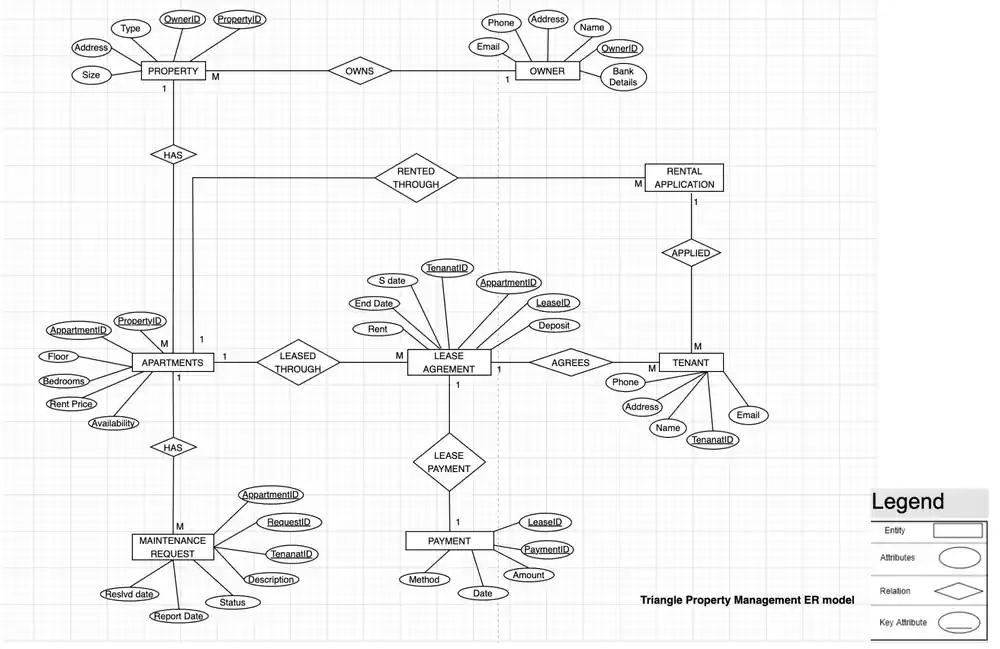

# TRIANGLE Property Management System (SQL)

A relational database for a property-management company. It tracks owners, properties, apartments, tenants, rental applications, leases, payments and maintenance requests, and includes SQL queries from basic to advanced.

*Course project (SQL Signature Project) at San Francisco Bay University.*

## Highlights

- **8-table relational schema:** Owner, Tenant, Property, Apartments, Rental Application, Lease, Payment, Maintenance Request.
- **ER model with clear cardinalities.** For example, one owner has many properties, one property has many apartments, and one apartment has many maintenance requests.
- **Queries cover:**
  - **Basic:** `SELECT`, `ALTER`, `UPDATE`, `ORDER BY`, `GROUP BY`
  - **Intermediate:** `INNER`, `LEFT` and `RIGHT` joins
  - **Advanced:** nested two-way inner and right joins using derived tables
- **Sample data** with 10 rows per table, so every query returns results.

## ER Diagram



## Project Structure

```
property-management-system-sql/
├── schema.sql        # creates all tables (safe to re-run: drops existing tables first)
├── sample_data.sql   # inserts the sample dataset
├── queries.sql       # Basic / Intermediate / Advanced queries
├── er_diagram.webp   # entity-relationship diagram
├── docs/
│   └── presentation.pdf    # project presentation (ER model, schemas, query results)
└── README.md
```

## Requirements

- **MySQL 8.0+** or **MariaDB 10.5+**
- A SQL client: the `mysql` command line, MySQL Workbench, or similar

No passwords or connection settings are stored in this repo. You use your own local database login.

## How to Run

**Command line**

```bash
# 1. Create a database
mysql -u root -p -e "CREATE DATABASE triangle_db;"

# 2. Create the tables, load the data, run the queries
mysql -u root -p triangle_db < schema.sql
mysql -u root -p triangle_db < sample_data.sql
mysql -u root -p triangle_db < queries.sql
```

**MySQL Workbench:** create a schema named `triangle_db`, then open and run `schema.sql`, `sample_data.sql` and `queries.sql`, in that order.

`queries.sql` changes data: it adds a `Description` column and updates rents. To run it a second time, run `schema.sql` and `sample_data.sql` again first.

All three scripts were tested end-to-end on MariaDB 10.11 and run without errors.

## Example Queries

```sql
-- Average rent by number of bedrooms
SELECT bedrooms, ROUND(AVG(rent_price), 2) AS AverageRent
FROM apartments
GROUP BY bedrooms;

-- Each apartment with its property address and owner (nested inner join)
SELECT A.*, PO.PropertyAddress, PO.OwnerName
FROM apartments A
INNER JOIN (
    SELECT P.propertyid, P.address AS PropertyAddress, O.name AS OwnerName
    FROM Property P
    INNER JOIN Owner O ON P.ownerid = O.ownerid
) AS PO ON A.propertyid = PO.propertyid;
```

## Presentation

The full slide deck, with the ER model, relationships, table schemas and screenshots of each query's output, is in [`docs/presentation.pdf`](docs/presentation.pdf).

## Author

**Md Azmir Bhuiyan**, Computer Science, San Francisco Bay University · [LinkedIn](https://www.linkedin.com/in/md-azmir-bhuiyan-97174034b)
